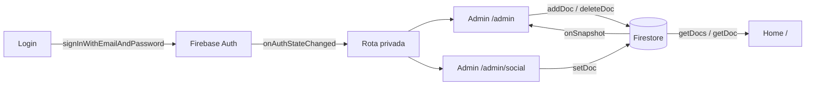

# 🔗 DevLink — Gerenciador de Links com React + Firebase

Uma página de links no estilo "link na bio" (Linktree), com **painel administrativo protegido por login**. Os links e as redes sociais ficam salvos em um banco de dados **Firebase Firestore** e são consumidos em tempo real pela aplicação React.

O projeto foi criado como estudo prático de **React.js** (com ênfase em `useState` e `useEffect`) e de **integração com Firebase** (Firestore + Authentication).

---

## 📸 Visão geral

| Rota | Acesso | O que faz |
| --- | --- | --- |
| `/` | Público | Exibe o nome, os links cadastrados (com cores personalizadas) e os ícones das redes sociais |
| `/login` | Público | Tela de login com e-mail e senha (Firebase Authentication) |
| `/admin` | 🔒 Privado | Cadastra, visualiza (com preview ao vivo) e exclui links |
| `/admin/social` | 🔒 Privado | Cadastra e atualiza os links de Facebook, Instagram e YouTube |
| `*` | Público | Página 404 |

---

## 🛠️ Tecnologias

- **[React 19](https://react.dev/)** — biblioteca de interface (hooks `useState` e `useEffect`)
- **[React Router DOM](https://reactrouter.com/)** — rotas com `createBrowserRouter` e rotas protegidas
- **[Firebase](https://firebase.google.com/) (SDK modular v9+)**
  - **Cloud Firestore** — banco de dados NoSQL de documentos
  - **Authentication** — login por e-mail e senha
- **[Tailwind CSS v4](https://tailwindcss.com/)** — estilização utilitária
- **[React Icons](https://react-icons.github.io/react-icons/)** — ícones (redes sociais, lixeira, logout)
- **[Vite](https://vitejs.dev/)** — ambiente de desenvolvimento e build

---

## 🗄️ Banco de dados: Firebase Firestore

O Firestore é um banco **NoSQL** organizado em **coleções** (pastas) que contêm **documentos** (objetos parecidos com JSON). Aqui o projeto usa duas estruturas.

### Modelo de dados

```
Firestore
├── Links (coleção)                  ← vários documentos, um por link
│   └── {id automático}
│       ├── name:    "Meu Instagram"     (string)
│       ├── url:     "https://..."       (string)
│       ├── bg:      "#121212"           (string — cor de fundo do botão)
│       ├── color:   "#f1f1f1"           (string — cor do texto)
│       └── created: Timestamp           (data de criação, usada para ordenar)
│
└── social (coleção)
    └── link (documento fixo)        ← um único documento com as redes sociais
        ├── facebook:  "https://..."
        ├── instagram: "https://..."
        └── youtube:   "https://..."
```

**Por que dois formatos?**
- `Links` é uma **lista** que cresce → coleção com IDs gerados automaticamente.
- `social/link` é uma **configuração única** → um documento com ID fixo (`link`), que é sobrescrito a cada salvamento.

### Como criar o banco no Firebase

1. Acesse o [Console do Firebase](https://console.firebase.google.com/) e clique em **Adicionar projeto**.
2. No projeto, vá em **Build → Firestore Database → Criar banco de dados** (modo de produção).
3. Crie a coleção `Links` e a coleção `social` (com um documento de ID `link`). As coleções também são criadas automaticamente no primeiro cadastro feito pelo painel.
4. Vá em **Build → Authentication → Sign-in method** e ative **E-mail/senha**.
5. Em **Authentication → Users**, crie manualmente o usuário administrador (e-mail e senha).
6. Em **Configurações do projeto → Seus aplicativos**, registre um app **Web (`</>`)** e copie o objeto `firebaseConfig`.

### Configuração do Firebase no projeto

```js
// src/services/firebaseConnection.js
import { initializeApp } from 'firebase/app'
import { getFirestore } from 'firebase/firestore'
import { getAuth } from 'firebase/auth'

const firebaseConfig = {
  apiKey: import.meta.env.VITE_FIREBASE_API_KEY,
  authDomain: import.meta.env.VITE_FIREBASE_AUTH_DOMAIN,
  projectId: import.meta.env.VITE_FIREBASE_PROJECT_ID,
  storageBucket: import.meta.env.VITE_FIREBASE_STORAGE_BUCKET,
  messagingSenderId: import.meta.env.VITE_FIREBASE_MESSAGING_SENDER_ID,
  appId: import.meta.env.VITE_FIREBASE_APP_ID,
}

const firebaseApp = initializeApp(firebaseConfig)

export const auth = getAuth(firebaseApp)
export const db = getFirestore(firebaseApp)
```

### 🔐 Regras de segurança (muito importante)

A `apiKey` do Firebase Web **não é uma senha** — ela identifica o projeto e fica visível no código do navegador. Quem protege os dados são as **regras do Firestore**. Para este projeto, o ideal é: **qualquer pessoa lê, só usuário logado escreve**.

```
rules_version = '2';
service cloud.firestore {
  match /databases/{database}/documents {
    match /{document=**} {
      allow read: if true;
      allow write: if request.auth != null;
    }
  }
}
```

---

## 📡 Consumo do banco de dados (CRUD)

Todas as operações usam as funções do SDK modular `firebase/firestore`.

| Operação | Função do Firebase | Onde é usada |
| --- | --- | --- |
| **Ler** lista de links (uma vez) | `getDocs` + `query` + `orderBy` | Home `/` |
| **Ler** lista em **tempo real** | `onSnapshot` + `query` + `orderBy` | Painel `/admin` |
| **Ler** um documento | `getDoc` | Home e `/admin/social` |
| **Criar** documento (ID automático) | `addDoc` | Cadastrar link |
| **Criar/Sobrescrever** (ID fixo) | `setDoc` | Salvar redes sociais |
| **Excluir** | `deleteDoc` + `doc` | Excluir link |

### Lendo os links ordenados (Home)

```js
import { collection, getDocs, orderBy, query } from 'firebase/firestore'

const linksRef = collection(db, 'Links')
const queryRef = query(linksRef, orderBy('created', 'asc'))

getDocs(queryRef).then((snapshot) => {
  const lista = []

  snapshot.forEach((doc) => {
    lista.push({
      id: doc.id,
      name: doc.data().name,
      url: doc.data().url,
      bg: doc.data().bg,
      color: doc.data().color,
    })
  })

  setLinks(lista) // guarda no estado e o React redesenha a tela
})
```

### Escutando mudanças em tempo real (Admin)

```js
import { onSnapshot } from 'firebase/firestore'

const unsub = onSnapshot(queryRef, (snapshot) => {
  const lista = []
  snapshot.forEach((doc) => lista.push({ id: doc.id, ...doc.data() }))
  setLinks(lista)
})

// função de limpeza: para de "ouvir" quando o componente sai da tela
return () => unsub()
```

> Com `onSnapshot`, ao cadastrar ou excluir um link o painel atualiza **sozinho**, sem recarregar a página nem refazer a busca manualmente.

### Cadastrando, atualizando e excluindo

```js
import { addDoc, setDoc, deleteDoc, doc, collection } from 'firebase/firestore'

// CREATE — ID gerado automaticamente
await addDoc(collection(db, 'Links'), {
  name, url, bg, color,
  created: new Date(),
})

// CREATE/UPDATE — documento com ID fixo ("social/link")
await setDoc(doc(db, 'social', 'link'), { facebook, instagram, youtube })

// DELETE
await deleteDoc(doc(db, 'Links', id))
```

### Fluxo dos dados



---

## 🔑 Autenticação e rotas privadas

O login usa **Firebase Authentication** (e-mail e senha):

```js
import { signInWithEmailAndPassword, signOut, onAuthStateChanged } from 'firebase/auth'

signInWithEmailAndPassword(auth, email, password) // entrar
signOut(auth)                                     // sair
onAuthStateChanged(auth, (user) => { /* ... */ }) // observar se há usuário logado
```

O componente `Private` envolve as rotas `/admin` e `/admin/social`. Ele pergunta ao Firebase se existe um usuário logado e decide: mostra a página, ou redireciona para `/login`.

```jsx
export function Private({ children }) {
  const [loading, setLoading] = useState(true)
  const [signed, setSigned] = useState(false)

  useEffect(() => {
    const unsub = onAuthStateChanged(auth, (user) => {
      if (user) {
        localStorage.setItem('@reactlinks', JSON.stringify({ uid: user.uid, email: user.email }))
        setSigned(true)
      } else {
        setSigned(false)
      }
      setLoading(false)
    })

    return () => unsub()
  }, [])

  if (loading) return <div></div>
  if (!signed) return <Navigate to="/login" />
  return children
}
```

---

## ⚛️ Estudo: `useState` e `useEffect` no React

Este projeto é um laboratório dos dois hooks mais importantes do React. Todos os exemplos abaixo vêm do próprio código.

### `useState` — a memória do componente

`useState` guarda um valor que, **quando muda, faz o componente ser redesenhado** na tela.

```jsx
const [name, setName] = useState('')   // [valor atual, função que altera]
```

**Onde foi usado:**

1. **Formulários controlados** (`/login`, `/admin`, `/admin/social`): cada `input` tem seu valor ligado a um estado.

   ```jsx
   <input value={name} onChange={(e) => setName(e.target.value)} />
   ```

2. **Preview ao vivo** (`/admin`): como `name`, `textColor` e `bgColor` são estados, o card "Veja como está ficando" se atualiza a cada letra digitada ou cor escolhida.

3. **Guardar dados vindos do banco**: os links do Firestore viram um array no estado `links`; as redes sociais viram um objeto no estado `social`.

4. **Controle de interface**: no `Private`, os estados `loading` e `signed` definem o que aparece (vazio, página ou redirecionamento).

> 📌 **Regra que aprendi:** nunca alterar o estado diretamente (`links.push(...)`). Sempre usar a função `setLinks(...)`, passando um valor novo.

### `useEffect` — executando efeitos colaterais

`useEffect` roda um código **depois que o componente é renderizado**. É o lugar certo para falar com o "mundo externo": banco de dados, API, timers, eventos.

```jsx
useEffect(() => {
  // o que executar
  return () => {
    // (opcional) limpeza ao desmontar
  }
}, [dependências])
```

**O array de dependências controla quando o efeito roda:**

| Formato | Quando executa |
| --- | --- |
| `useEffect(fn, [])` | **Uma vez**, quando o componente aparece na tela |
| `useEffect(fn, [x])` | Na primeira vez e **sempre que `x` mudar** |
| `useEffect(fn)` | A **cada** renderização (raramente desejável) |

**Onde foi usado:**

1. **Buscar dados ao abrir a página** (`[]`): na Home, dois `useEffect` buscam os links e as redes sociais no Firestore assim que a tela carrega.

   ```jsx
   useEffect(() => {
     function loadLinks() {
       getDocs(queryRef).then((snapshot) => { /* ... */ setLinks(lista) })
     }
     loadLinks()
   }, [])
   ```

2. **Assinar atualizações em tempo real com limpeza** (`/admin`): o `onSnapshot` abre uma conexão com o banco. A função retornada pelo effect **cancela a assinatura** quando o usuário sai da página, evitando vazamento de memória.

   ```jsx
   useEffect(() => {
     const unsub = onSnapshot(queryRef, (snapshot) => { /* ... */ })
     return () => unsub()
   }, [])
   ```

3. **Observar o login** (`Private`): `onAuthStateChanged` também devolve uma função de cancelamento, usada no `return` do effect.

### Como os dois trabalham juntos

```
1. Componente aparece na tela (estado inicial: links = [])
2. useEffect executa → busca os dados no Firestore
3. Dados chegam → setLinks(lista) atualiza o useState
4. React detecta a mudança de estado → redesenha a tela com os links
```

### Pontos de atenção que o estudo revelou

- Um effect com `[]` **não** deve depender de valores que mudam; se depender, inclua-os no array.
- Quando um effect abre algo que "continua ouvindo" (`onSnapshot`, `onAuthStateChanged`), **sempre** retorne a função de limpeza.
- No modo `StrictMode` do React, em desenvolvimento os effects rodam duas vezes de propósito — é o React ajudando a achar falta de limpeza.
- A atualização do estado é **assíncrona**: logo após `setX(valor)`, a variável `x` ainda tem o valor antigo naquela execução.

---

## 📁 Estrutura sugerida do projeto

```
react-links/
├── public/
│   └── favicon.svg
├── src/
│   ├── components/
│   │   ├── Header/          # navegação do painel + botão de sair
│   │   ├── Input/           # input reutilizável
│   │   └── Social/          # ícone com link das redes sociais
│   ├── pages/
│   │   ├── Home/
│   │   ├── Login/
│   │   ├── Admin/
│   │   ├── Networks/        # /admin/social
│   │   └── ErrorPage/       # 404
│   ├── services/
│   │   └── firebaseConnection.js
│   ├── routes/
│   │   └── private.jsx
│   ├── App.jsx
│   ├── main.jsx
│   └── index.css
├── index.html
├── package.json
└── vite.config.js
```

---

## 🚀 Como rodar o projeto

### Pré-requisitos

- [Node.js](https://nodejs.org/) 18 ou superior
- Um projeto no Firebase configurado (veja a seção do banco de dados)

### Passo a passo

```bash
# 1. Clone o repositório
git clone https://github.com/SEU-USUARIO/react-links.git

# 2. Entre na pasta
cd react-links

# 3. Instale as dependências
npm install

# 4. Crie o arquivo .env na raiz com as chaves do seu Firebase
#    (veja o modelo abaixo)

# 5. Rode em modo de desenvolvimento
npm run dev
```

Acesse `http://localhost:5173`.

### Variáveis de ambiente (`.env`)

```env
VITE_FIREBASE_API_KEY=
VITE_FIREBASE_AUTH_DOMAIN=
VITE_FIREBASE_PROJECT_ID=
VITE_FIREBASE_STORAGE_BUCKET=
VITE_FIREBASE_MESSAGING_SENDER_ID=
VITE_FIREBASE_APP_ID=
```

> ⚠️ O arquivo `.env` deve estar no `.gitignore`. Nunca suba suas chaves para o GitHub.

### Gerar o build de produção

```bash
npm run build     # gera a pasta dist/
npm run preview   # testa o build localmente
```

---

## 📚 O que aprendi

- Criar e estruturar um banco **NoSQL** no Firebase Firestore (coleções e documentos)
- Fazer um **CRUD completo** com `addDoc`, `getDocs`, `getDoc`, `setDoc`, `deleteDoc` e `onSnapshot`
- Ordenar consultas com `query` e `orderBy`
- Implementar **autenticação** com e-mail e senha e **rotas privadas** com React Router
- Dominar o ciclo `useState` → `useEffect` → renderização
- Usar **funções de limpeza** em effects para evitar vazamentos
- Criar **formulários controlados** e preview em tempo real
- Estilizar com **Tailwind CSS** e proteger o banco com **regras de segurança**

---

## 🔮 Próximos passos

- [ ] Permitir editar links já cadastrados
- [ ] Reordenar links por arrastar e soltar (campo `order`)
- [ ] Adicionar mais redes sociais (LinkedIn, WhatsApp, GitHub)
- [ ] Contador de cliques por link
- [ ] Deploy (Vercel, Netlify ou Firebase Hosting)

---

## 👨‍💻 Autor

**Gabriel Reis**

[](https://github.com/SEU-USUARIO)

---

⭐ Se este projeto te ajudou nos estudos, deixe uma estrela no repositório!
